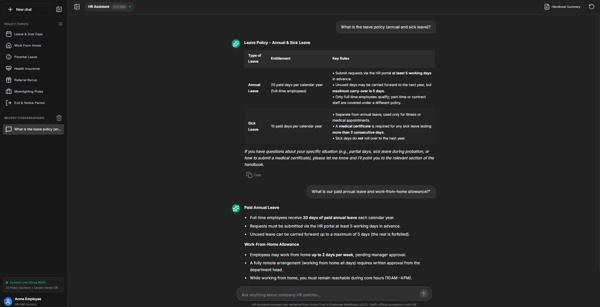

# HR Policy Assistant (RAG)

A retrieval-augmented generation (RAG) chatbot that answers employee questions about a company's HR policy document. Built with **LangChain**, a **Groq-hosted LLM** (`openai/gpt-oss-20b`), **Jina embeddings** (`jina-embeddings-v2-base-en`), a **Qdrant Cloud** vector store, and a **ChatGPT-style Web UI** powered by **FastAPI**, with input/output safety guardrails, per-run logging, and evaluation suites.



---

## Key Features

- **ChatGPT-Style Web UI**: Modern dark theme with collapsible sidebar, session history in `localStorage`, 4 quick-action prompt cards, live typing indicator, and copy-to-clipboard markdown formatting.
- **20 Comprehensive HR Policies**: Covers Leave, WFH, Probation, Exit, Maternity/Paternity, Health Insurance, Overtime, Tuition Reimbursement, Appraisals, POSH, Moonlighting, Travel, and Referral Bonuses.
- **Accurate & Grounded Retrieval**: Chunks stored and queried from managed Qdrant Cloud with Jina dense vector embeddings.
- **Multi-Layer Safety Guardrails**: Screens incoming user questions (prompt injection, unauthorized data access) and outgoing answers (PII leaks, unauthorized promises) using a Groq safety model.
- **Dockerized Microservice Architecture**: Production-ready `Dockerfile` and `docker-compose.yml` with health endpoints (`/health` and `/_stcore/health`).

---

## How It Works

1. **Ingest** — [`hr_assistant/document_loader.py`](hr_assistant/document_loader.py) loads [`data/hr_policy.txt`](data/hr_policy.txt), and [`hr_assistant/splitter.py`](hr_assistant/splitter.py) splits it into chunks (`CHUNK_SIZE=500`, `CHUNK_OVERLAP=60`).
2. **Embed & Store** — [`hr_assistant/embeddings.py`](hr_assistant/embeddings.py) generates embeddings with Jina (`jina-embeddings-v2-base-en`), and [`hr_assistant/vector_store.py`](hr_assistant/vector_store.py) uploads them to a Qdrant Cloud collection (`hr_policy`). Existing collections are reused on subsequent runs.
3. **Retrieve** — [`hr_assistant/tools.py`](hr_assistant/tools.py) wraps the vector store retriever (top-k = 3) as a `search_hr_policy` tool.
4. **LLM** — [`hr_assistant/llm.py`](hr_assistant/llm.py) connects directly to Groq (`openai/gpt-oss-20b`) for fast inference (with optional Portkey gateway support).
5. **Agent** — [`hr_assistant/agent.py`](hr_assistant/agent.py) builds a tool-calling LangChain agent that retrieves ground-truth policy clauses before formulating answers.
6. **Guardrails** — [`hr_assistant/guardrails.py`](hr_assistant/guardrails.py) screens questions and responses with a Groq safeguard model (`openai/gpt-oss-safeguard-20b`).
7. **Pipeline & API** — [`hr_assistant/pipeline.py`](hr_assistant/pipeline.py) wires the entire flow together. [`app.py`](app.py) serves the web app and REST API (`/api/chat`).

---

## Project Layout

```
hr-rag-deployment/
├── app.py                 # FastAPI backend & API endpoints (/api/chat, /health)
├── static/                # ChatGPT-style Web UI
│   ├── index.html         # Single-page application structure & modals
│   ├── css/style.css      # Custom ChatGPT dark mode design system
│   └── js/app.js          # Chat client, history persistence & markdown renderer
├── hr_assistant/
│   ├── config.py          # Settings, env vars, check_api_keys()
│   ├── pipeline.py        # build_hr_assistant(), ask() - main entry pipeline
│   ├── agent.py           # LangChain tool-calling agent construction
│   ├── tools.py           # search_hr_policy retrieval tool
│   ├── vector_store.py    # Qdrant Cloud index, search, and delete
│   ├── embeddings.py      # Jina AI embeddings model
│   ├── document_loader.py # Document loading (data/hr_policy.txt)
│   ├── splitter.py        # Recursive text chunking
│   ├── llm.py             # ChatGroq LLM initialization
│   ├── guardrails.py      # Input/output safety screening
│   ├── evaluation.py      # LangSmith dataset & correctness judges
│   ├── logger.py          # Shared per-run file logger (logs/)
│   └── tracing.py         # LangSmith tracing status logger
├── data/
│   └── hr_policy.txt      # Source HR policy document (20 sections)
├── evaluate.py            # Evaluation test runner
├── main.py                # CLI demo runner
├── Dockerfile             # Multi-stage image build (uv install, port 8501)
├── docker-compose.yml     # App service + eval job definition
├── .env.example           # Environment template
└── image.png              # UI preview screenshot
```

---

## Quickstart

### Option 1: Docker Compose (Recommended)

1. Create your `.env` file from the template:
   ```bash
   cp .env.example .env
   ```
2. Fill in your API keys in `.env` (Groq, Jina, Qdrant).
3. Build and run:
   ```bash
   docker compose up -d --build app
   ```
4. Open **http://localhost:8501** in your browser.

To stop the container:
```bash
docker compose down
```

---

### Option 2: Local Python Environment

1. Install [uv](https://github.com/astral-sh/uv):
   ```bash
   pip install uv
   ```
2. Create and activate a virtual environment:
   ```bash
   uv venv hrenv
   # Windows:
   hrenv\Scripts\activate
   # macOS/Linux:
   source hrenv/bin/activate
   ```
3. Install dependencies:
   ```bash
   uv pip install -r requirements.txt
   ```
4. Configure `.env` with your API keys.
5. Run the web app:
   ```bash
   python app.py
   ```
6. Open **http://localhost:8501** in your browser.

---

## Environment Variables

Configure these in `.env`:

```env
# --- Groq ---
# Required: Powers the main LLM and the guardrail safety model
GROQ_API_KEY=gsk_...

# --- Jina AI ---
# Required: Embeddings model for policy chunking (jina-embeddings-v2-base-en)
JINA_API_KEY=jina_...

# --- Qdrant Cloud Vector Store ---
# Required: Cloud vector database endpoint & authentication
# NOTE: Ensure the URL ends with ':443' to prevent connection reset errors.
QDRANT_URL=https://<cluster-id>.<region>.aws.cloud.qdrant.io:443
QDRANT_API_KEY=...
QDRANT_COLLECTION_NAME=hr_policy

# --- LangSmith Tracing & Evaluation (Optional) ---
# Set LANGSMITH_TRACING=true only if you have an API key configured
LANGSMITH_TRACING=false
LANGSMITH_ENDPOINT=https://api.smith.langchain.com
LANGSMITH_API_KEY=...
LANGSMITH_PROJECT=hr_policy_assistant
```

---

## Evaluations

Run the correctness and groundedness evaluation suite:

```bash
# Locally:
python evaluate.py

# In Docker:
docker compose run eval
```

---

## Notes & Troubleshooting

- **Qdrant Cloud Port**: Always append `:443` to `QDRANT_URL` (e.g. `https://xxxx.aws.cloud.qdrant.io:443`). Without `:443`, connections on Windows may fail with `[WinError 10054] connection reset`.
- **Health Checks**: The app serves `/health` and `/_stcore/health` for automated container orchestrators and load balancers.
